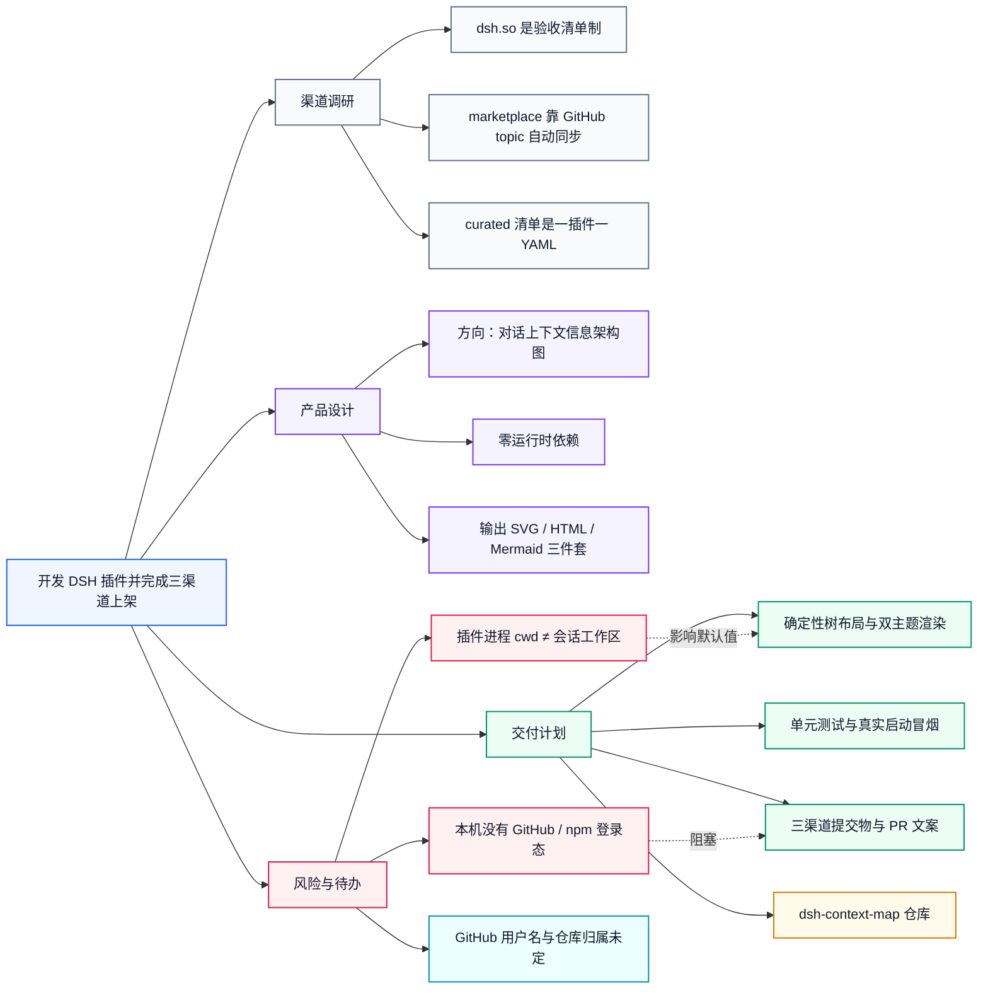

# 把 DSH 插件做成三个渠道都能上架的产品

> 本次对话的上下文结构：调研、设计、交付与风险

> 18 个节点 · 3 层 · 2 条关联 · 生成于 2026-11-04

## 结构

- **目标** 开发 DSH 插件并完成三渠道上架 — 能装、能用、能过安全扫描，不是占位 demo · 进行中
  - **背景** 渠道调研 — 三个目录的收录机制各不相同，必须先摸清规则 · 已完成
    - **背景** dsh.so 是验收清单制 — dsh 字段 / cordis 清单 / DSH topic 三者有其一；README 带安装说明；SPDX 许可证；源码可扫描
    - **背景** marketplace 靠 GitHub topic 自动同步 — 仓库描述即卡片摘要，README 即详情页，缺 LICENSE 会被标注为保留所有权利
    - **背景** curated 清单是一插件一 YAML — data/plugins/&lt;owner&gt;__&lt;repo&gt;.yml，README 由脚本生成，不要手改
  - **决策** 产品设计 — 四件事定下来，后面只是执行 · 已完成
    - **决策** 方向：对话上下文信息架构图 — 目标、背景、决策、动作、产物、风险、待确认分组成图 · 已完成
    - **决策** 零运行时依赖 — 直接注册原始 ToolDefinition，parameters 写 JSON Schema，不跟随作者 DSL 漂移 · 已完成
    - **决策** 输出 SVG / HTML / Mermaid 三件套 — SVG 进文档，HTML 给人看，Markdown 进 PR 可审阅 · 已完成
  - **动作** 交付计划 — 从渲染内核到三份提交物 · 进行中
    - **动作** 确定性树布局与双主题渲染 — 无 canvas、无随机数，同输入永远得到同一张图 · 进行中
    - **动作** 单元测试与真实启动冒烟 — 覆盖规格校验、布局不重叠、转义、插件注册与写盘 · 计划中
    - **动作** 三渠道提交物与 PR 文案 — dsh.so 提交串、marketplace 表单、两处 curated 清单补丁 · 计划中
    - **产物** dsh-context-map 仓库 — lib/、bin/、docs/、examples/、LICENSE、CI · 进行中
  - **风险** 风险与待办 — 上架前必须解决的两件事 · 进行中
    - **风险** 本机没有 GitHub / npm 登录态 — 推仓库、发 npm 包、开 PR 都需要你完成一次授权 · 受阻
    - **风险** 插件进程 cwd ≠ 会话工作区 — 默认输出目录可能落在应用目录，模型应显式传绝对 outDir · 进行中
    - **待确认** GitHub 用户名与仓库归属未定 — 决定 curated 文件名与全部链接

## 类型分布

| 类型 | 数量 |
| --- | --- |
| 目标 (`goal`) | 1 |
| 背景 (`context`) | 4 |
| 决策 (`decision`) | 4 |
| 动作 (`action`) | 4 |
| 产物 (`artifact`) | 1 |
| 风险 (`risk`) | 3 |
| 待确认 (`question`) | 1 |

## 节点清单

| # | 节点清单 | 类型分布 | 状态 |
| --- | --- | --- | --- |
| 1 | 开发 DSH 插件并完成三渠道上架 | 目标 | 进行中 |
| 2 | 渠道调研 | 背景 | 已完成 |
| 3 | dsh.so 是验收清单制 | 背景 | 未标注 |
| 4 | marketplace 靠 GitHub topic 自动同步 | 背景 | 未标注 |
| 5 | curated 清单是一插件一 YAML | 背景 | 未标注 |
| 6 | 产品设计 | 决策 | 已完成 |
| 7 | 方向：对话上下文信息架构图 | 决策 | 已完成 |
| 8 | 零运行时依赖 | 决策 | 已完成 |
| 9 | 输出 SVG / HTML / Mermaid 三件套 | 决策 | 已完成 |
| 10 | 交付计划 | 动作 | 进行中 |
| 11 | 确定性树布局与双主题渲染 | 动作 | 进行中 |
| 12 | 单元测试与真实启动冒烟 | 动作 | 计划中 |
| 13 | 三渠道提交物与 PR 文案 | 动作 | 计划中 |
| 14 | dsh-context-map 仓库 | 产物 | 进行中 |
| 15 | 风险与待办 | 风险 | 进行中 |
| 16 | 本机没有 GitHub / npm 登录态 | 风险 | 受阻 |
| 17 | 插件进程 cwd ≠ 会话工作区 | 风险 | 进行中 |
| 18 | GitHub 用户名与仓库归属未定 | 待确认 | 未标注 |

## 输出文件

- `context-map-example.svg`
- `context-map-example.html`
- `context-map-example.md`
- `context-map-example.json`

dsh-context-map v0.3.0 · 根据对话纲要生成
